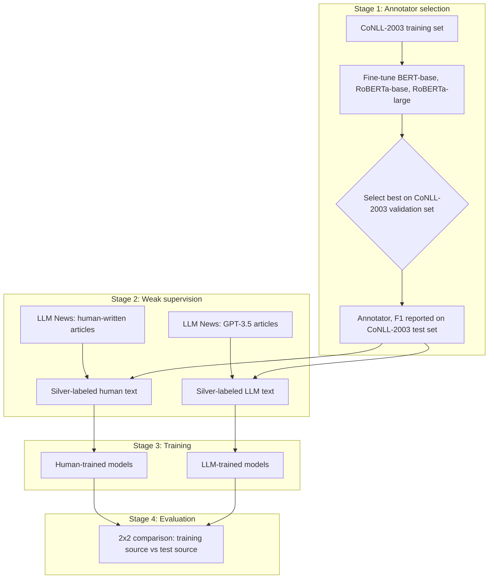

# Human-Written vs LLM-Generated News: A Weakly Supervised Comparison of Named Entity Recognition


> Does Named Entity Recognition work as well on AI-written news as on human-written news, and can AI-written articles replace human-written ones as training data?

## Table of Contents

- [Overview](#overview)
- [Research Questions](#research-questions)
- [Architecture](#architecture)
- [Datasets](#datasets)
- [Models](#models)
- [Evaluation](#evaluation)
- [Repository Structure](#repository-structure)
- [Getting Started](#getting-started)
- [Results](#results)
- [Team](#team)
- [Acknowledgments](#acknowledgments)
- [License](#license)

## Overview

Named Entity Recognition (NER) models are trained and evaluated almost entirely on human-written text, while a growing share of online text is now generated by large language models (LLMs). This project compares NER on **matched pairs** of human-written news articles and their GPT-3.5-generated counterparts. Because the generated text has no entity annotations, labels are produced through **weak supervision**: a NER model trained on the human-annotated CoNLL-2003 dataset annotates both sides.

## Research Questions

1. Does NER performance differ between human-written and LLM-generated news text?
2. How well do models trained on LLM-generated text transfer to human-written text, and vice versa?
3. Which entity types and topics are most affected by the origin of the text?

## Architecture

The project runs in four stages:



| Stage | What happens |
|---|---|
| 1. Annotator selection | Three candidates are fine-tuned on CoNLL-2003; the best on the validation set becomes the annotator, and its test-set F1 estimates label quality |
| 2. Weak supervision | The annotator labels matched human-written and GPT-3.5-generated articles, producing silver labels |
| 3. Training | Each main model and the CRF baseline are trained once on human text and once on LLM text |
| 4. Evaluation | Every model is tested on both human and LLM test articles; `06_analysis.ipynb` combines all four models (3 transformers + CRF) into one joint bootstrap comparison and answers RQ1-3 |

## Datasets

| Dataset | Description | Role |
|---|---|---|
| [LLM-generated News](https://github.com/navid-aub/News-Dataset) | 3,000 news articles from 9 outlets across 6 topics, each paired with LLM-generated versions | Human vs LLM text |
| [CoNLL-2003](https://huggingface.co/datasets/eriktks/conll2003) | Reuters news annotated with person, organization, location, and miscellaneous entities | Annotator training/selection |

## Models

| Stage | Models |
|---|---|
| Annotator candidates | BERT-base, RoBERTa-base, RoBERTa-large — RoBERTa-large selected (CoNLL-2003 test F1 0.9273) |
| Main models | BERT-base (cased), RoBERTa-base, DistilBERT-base (cased) |
| Baseline | Linear-chain CRF with hand-crafted word features |

## Evaluation

- Entity-level precision, recall, micro F1, macro F1, and per-type F1 using `seqeval` (exact span and type match)
- Results broken down by entity type and topic
- 95% bootstrap confidence intervals for differences between conditions

## Repository Structure

```
├── data/          # Dataset docs only (raw/processed data not tracked, see data/README.md)
├── notebooks/     # Colab notebooks, numbered in pipeline order
├── reports/       # Proposal, progress update, and final report (not yet added)
└── README.md
```

Checkpoints, metrics, and figures are not stored in this repository. Every notebook writes its outputs
(datasets, model checkpoints, result tables, plots, logs) to a shared Google Drive folder
(`IT469-NER-Project`) mounted at run time, so large artifacts never need to go through git.

## Getting Started

All experiments run in Google Colab. Open the notebooks in order:

| Notebook | Step |
|---|---|
| `01_data_preparation.ipynb` | Clean, sample, and tokenize the LLM News dataset |
| `02_annotator_selection-bert-base-cased.ipynb`, `02_annotator_selection - roberta-base.ipynb`, `02_annotator_selection - roberta-large.ipynb` | Fine-tune each annotator candidate on CoNLL-2003 (one executed notebook per candidate, archived with its results) |
| `03_silver_labeling.ipynb` | Annotate human and LLM articles |
| `04_crf_baseline.ipynb` | Train and evaluate the CRF baseline |
| `05_main_models_bert_base_cased.ipynb`, `05_main_models-roberta-base.ipynb`, `05_main_models-distilbert-base-cased.ipynb` | Train and evaluate each main model, once per text source (one executed notebook per model, archived with its results) |
| `06_analysis.ipynb` | Combine all four models into one cross-model comparison: joint bootstrap, confusion matrices, RQ1-3, vocabulary/error analysis |

## Results

All four pipeline stages are complete: annotator selection, silver labeling, training (the CRF baseline
plus three main transformer models, each trained once on human text and once on GPT-3.5 text), and a final
cross-model evaluation that combines all four models in `06_analysis.ipynb`.

Every number below measures agreement with the **silver labels** produced by the selected annotator
(`roberta-large`, CoNLL-2003 test F1 **0.9273**), not independent human ground truth on the LLM News
articles — no such ground truth exists for that dataset. Each transformer was trained with a single fixed
seed (42); the CRF is deterministic given its hyperparameters.

### 2x2 micro F1 — all four models

| Model | Human-trained → Human test | Human-trained → LLM test | LLM-trained → Human test | LLM-trained → LLM test |
|---|---|---|---|---|
| **RoBERTa-base** | 0.9408 | 0.9422 | 0.9355 | 0.9469 |
| **BERT-base** | 0.9290 | 0.9363 | 0.9160 | 0.9388 |
| **DistilBERT-base** | 0.9148 | 0.9248 | 0.8946 | 0.9265 |
| **CRF baseline** | 0.8530 | 0.8691 | 0.8049 | 0.8714 |

`06_analysis.ipynb` runs one joint paired bootstrap over all 16 (model, train-source, test-source)
combinations at once (1,000 resamples, one shared resample of test articles across every comparison, so
cross-model differences are properly paired). Two findings hold up across the **entire** 2x2 design, not
just one slice of it:

- **Every transformer reliably beats the CRF baseline in all 4 cells** (12/12 comparisons reliable, +5.5
  to +13.1 F1 points) — contextual pretraining helps substantially over hand-crafted lexical features here.
- **RoBERTa-base reliably beats BERT-base, and BERT-base reliably beats DistilBERT-base, in all 4 cells**
  (12/12 pairwise comparisons reliable) — the capacity/pretraining-quality ordering is consistent
  everywhere in the design.

### RQ1 — Does NER work as well on LLM-generated text as on human-written text?

**No.** Holding the training source fixed and comparing test performance, every model scores lower on
human-written test text than on GPT-3.5-generated test text; the gap is statistically reliable in 6 of 8
(model, training-source) checks (the two unreliable cases — human-trained BERT-base and human-trained
RoBERTa-base — are close to zero either way). This is consistent with an earlier finding from the
silver-labeling stage: GPT-3.5's rewrites carry noticeably fewer named entities per 100 tokens than the
original journalism, which makes LLM-generated text an easier NER target for every model, not just the
CRF. The size of this penalty for an LLM-trained model moved to human test text ranges from **1.1 points
(RoBERTa-base) to 3.2 points (DistilBERT-base)** for the transformers, versus **6.7 points for the CRF** —
contextual pretraining does not remove the domain-shift penalty, but it substantially cushions it.

### RQ2 — Can LLM-generated articles substitute for human-written ones as training data?

**Not fully.** Holding the test source fixed and comparing training sources: training on human text
reliably beats training on LLM text when tested on human text, for **all four models** (+0.5 to +4.8 F1
points, all reliable). When tested on LLM text instead, the training-source choice is not statistically
reliable for three of the four models; RoBERTa-base is the one exception, with a small but reliable edge
for LLM-trained in that cell (0.47 points). So the risk of training on LLM-generated text is real and
consistent in direction across every model, but — as in RQ1 — far smaller in magnitude for the
transformers than for the CRF.

### RQ3 — Which entity types and topics are most affected by text origin?

On the **LLM-trained** side (the larger, more reliable effect in RQ1/RQ2), all four models agree: **MISC
and ORG** entities are the two most affected by text origin, and **PER** is consistently the least
affected — organization and miscellaneous-entity names are where real journalism is most lexically
diverse. The **human-trained** side is less consistent (RoBERTa-base and the CRF each rank one type
differently from the other three), which is part of why the overall cross-model rank correlation for
entity types is only **0.56** on average. Topic rankings agree far more across all four models (mean
rank correlation **0.82**): **Celebrity** news (tied with **Sports** for the CRF) is consistently the
topic most affected by text origin, while **History and religion** or **Science and technology** are
consistently among the least affected — sports/celebrity journalism leans on award names, nicknames, and
informal team references (MISC-heavy), while history/religion and science/technology coverage use more
standardized terminology that both human and GPT-3.5 writing phrase similarly.

### Bottom line

LLM-generated text is **not** a fully safe substitute for human-written text as NER training data — every
effect above points the same direction for all four models tested, including three genuinely different
transformer architectures, not just one classical baseline. But the *size* of that risk depends heavily on
the model: large for a feature-based CRF, consistently smaller — though never zero — for pretrained
transformer encoders, with RoBERTa-base the most robust of the three.

Full per-type/per-topic tables, confusion matrices (token-level and entity-level, with a
correct/wrong-type/partial/missed/spurious breakdown), a vocabulary-memorization check, and example errors
per model are saved under `results/analysis/` on the shared Drive by `06_analysis.ipynb`; each model's own
grid-search details, learning curves, and 2x2 breakdown are in its own `05_main_models-*.ipynb` /
`04_crf_baseline.ipynb` saved outputs.

## Team


- Layan Murayshid
- Aryam Almutairi
- Leen Bin Muayqil
- Shahad Alotaibi
- Nora Alkhudair
- Ghalia Alkhaldi
- Rana Alnajashi


## Acknowledgments

- N. Ayoobi, S. Shahriar, and A. Mukherjee, "Seeing Through AI's Lens: Enhancing Human Skepticism Towards LLM-Generated Fake News," *ACM HT*, 2024.
- E. F. Tjong Kim Sang and F. De Meulder, "Introduction to the CoNLL-2003 Shared Task: Language-Independent Named Entity Recognition," *CoNLL*, 2003.
- Official CoNLL-2003 shared task page: https://www.clips.uantwerpen.be/conll2003/ner/

## License

Code in this repository is released under the [MIT License](LICENSE). Datasets remain under their original licenses.
