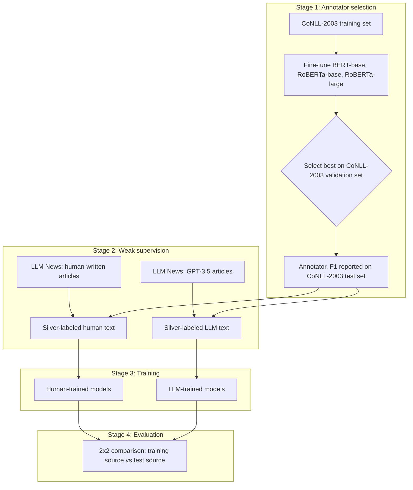

# Human-Written vs LLM-Generated News: A Weakly Supervised Comparison of Named Entity Recognition


> Does Named Entity Recognition work as well on AI-written news as on human-written news, and can AI-written articles replace human-written ones as training data?

## Table of Contents

- [Overview](#overview)
- [Research Questions](#research-questions)
- [Architecture](#architecture)
- [Datasets](#datasets)
- [Models](#models)
- [Evaluation](#evaluation)
- [Repository Structure](#repository-structure)
- [Getting Started](#getting-started)
- [Results](#results)
- [Team](#team)
- [Acknowledgments](#acknowledgments)
- [License](#license)

## Overview

Named Entity Recognition (NER) models are trained and evaluated almost entirely on human-written text, while a growing share of online text is now generated by large language models (LLMs). This project compares NER on **matched pairs** of human-written news articles and their GPT-3.5-generated counterparts. Because the generated text has no entity annotations, labels are produced through **weak supervision**: a NER model trained on the human-annotated CoNLL-2003 dataset annotates both sides.

## Research Questions

1. Does NER performance differ between human-written and LLM-generated news text?
2. How well do models trained on LLM-generated text transfer to human-written text, and vice versa?
3. Which entity types and topics are most affected by the origin of the text?

## Architecture

The project runs in four stages:



| Stage | What happens |
|---|---|
| 1. Annotator selection | Three candidates are fine-tuned on CoNLL-2003; the best on the validation set becomes the annotator, and its test-set F1 estimates label quality |
| 2. Weak supervision | The annotator labels matched human-written and GPT-3.5-generated articles, producing silver labels |
| 3. Training | Each main model and the CRF baseline are trained once on human text and once on LLM text |
| 4. Evaluation | Every model is tested on both human and LLM test articles |

## Datasets

| Dataset | Description | Role |
|---|---|---|
| [LLM-generated News](https://github.com/navid-aub/News-Dataset) | 3,000 news articles from 9 outlets across 6 topics, each paired with LLM-generated versions | Human vs LLM text |
| [CoNLL-2003](https://huggingface.co/datasets/eriktks/conll2003) | Reuters news annotated with person, organization, location, and miscellaneous entities | Annotator training/selection |

## Models

| Stage | Models |
|---|---|
| Annotator candidates | BERT-base, RoBERTa-base, RoBERTa-large |
| Main models | BERT-base, RoBERTa-base, DistilBERT |
| Baseline | Linear-chain CRF with hand-crafted word features |

## Evaluation

- Entity-level precision, recall, micro F1, macro F1, and per-type F1 using `seqeval` (exact span and type match)
- Results broken down by entity type and topic
- 95% bootstrap confidence intervals for differences between conditions

## Repository Structure

```
├── data/          # Dataset docs only (raw/processed data not tracked, see data/README.md)
├── notebooks/     # Colab notebooks, numbered in pipeline order
├── reports/       # Proposal, progress update, and final report (not yet added)
└── README.md
```

Checkpoints, metrics, and figures are not stored in this repository. Every notebook writes its outputs
(datasets, model checkpoints, result tables, plots, logs) to a shared Google Drive folder
(`IT469-NER-Project`) mounted at run time, so large artifacts never need to go through git.

## Getting Started

All experiments run in Google Colab. Open the notebooks in order:

| Notebook | Step |
|---|---|
| `01_data_preparation.ipynb` | Clean, sample, and tokenize the LLM News dataset |
| `02_annotator_selection-bert-base-cased.ipynb`, `02_annotator_selection - roberta-base.ipynb`, `02_annotator_selection - roberta-large.ipynb` | Fine-tune each annotator candidate on CoNLL-2003 (one executed notebook per candidate, archived with its results) |
| `03_silver_labeling.ipynb` | Annotate human and LLM articles |
| `04_crf_baseline.ipynb` | Train and evaluate the CRF baseline |
| `05_main_models.ipynb` | Train and evaluate the main models |
| `06_analysis.ipynb` | Per-type and per-topic analysis |

## Results

Full results are still in progress (main transformer models not yet trained). The CRF baseline
(`04_crf_baseline.ipynb`) is complete:

**2x2 micro F1** (linear-chain CRF, trained once on human text / once on LLM text, each tested on both):

| Trained on \ Tested on | Human test | LLM test |
|---|---|---|
| **Human** | 0.853 | 0.869 |
| **LLM** | 0.805 | 0.871 |

A paired bootstrap (1,000 resamples over the shared test articles, 95% CI) found three of the four
train/test differences statistically reliable. The standout: a CRF trained only on GPT-3.5 text loses
**6.7 F1 points** when evaluated on real journalism, while a CRF trained on human text loses almost
nothing (and even gains slightly) when evaluated on GPT-3.5 text — the human-trained model is the more
robust one. This tracks with an independent finding from the silver-labeling stage: only ~44% of a
journalist's entity mentions survive, as an exact string, into GPT-3.5's rewrite of the same story, and
entity-vocabulary overlap between train and test predicts the size of each F1 gap almost exactly. Full
breakdown (per-entity-type, bootstrap intervals, feature weights, and the leakage/overfitting checks that
back these numbers) is in the notebook's saved outputs.

**Baseline-level answer to the project's central question:** at least for a classical feature-based
model, LLM-generated text is *not* a safe substitute for human-written text as NER training data.

## Team


- Layan Murayshid
- Aryam Almutairi
- Leen Bin Muayqil
- Shahad Alotaibi
- Nora Alkhudair
- Ghalia Alkhaldi
- Rana Alnajashi


## Acknowledgments

- N. Ayoobi, S. Shahriar, and A. Mukherjee, "Seeing Through AI's Lens: Enhancing Human Skepticism Towards LLM-Generated Fake News," *ACM HT*, 2024.
- E. F. Tjong Kim Sang and F. De Meulder, "Introduction to the CoNLL-2003 Shared Task: Language-Independent Named Entity Recognition," *CoNLL*, 2003.
- Official CoNLL-2003 shared task page: https://www.clips.uantwerpen.be/conll2003/ner/

## License

Code in this repository is released under the [MIT License](LICENSE). Datasets remain under their original licenses.
